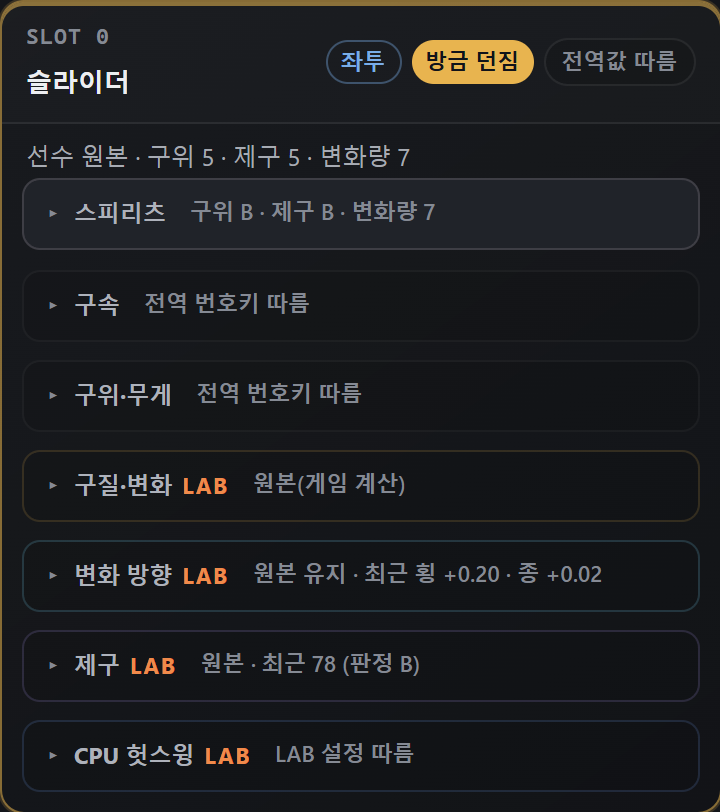

# 지난 공개판 안내

저장소 첫 화면(README)에 있던 0.7.234 누적 업데이트 표와 0.7.158 이전 공개판의 변경 안내를 2026년 11월 19일에 그대로 옮긴 문서입니다. 모든 버전의 변경은 [저장소 첫 화면의 전체 변경 이력](README.md#전체-변경-이력)에서 찾을 수 있습니다.

## 0.7.234 누적 업데이트

누적 기준 0.7.158 이후의 추가·수정·변경을 모두 포함합니다. 직전 공개판 0.7.224 이후의 **0.7.225~0.7.234** 변경은 위 0.7.234 절과 설명서 97~123장을, 0.7.224 변경은 설명서 95~96장을, 0.7.223 변경은 86~94장을, 0.7.221~0.7.222 변경은 79~85장을, 그 전 변경은 아래 버전별 목록과 설명서를 확인하세요. 76개 버전의 변화와 수정 경위는 [변경 기록](이전버전/CHANGES_0_7_159_TO_234.ko.md)에 있습니다.

| 영역 | 추가되거나 개선된 내용 |
| --- | --- |
| UI | 새 대시보드, 지금 켜진 기능, Ctrl+K 기능 찾기·초성 검색, 설명 팝업, 모드별 탭, 긴 화면 바로가기, 모드별 기능 OFF, 통합 상황실(자동 유지·직접 효과·계약·자금·외부 설정, 고시엔·엑시비전 보기), 화면 오류 상자, 옵션 기억(모드별·공통), 성능 · 게임 랙 관리 카드, 유저 옵션·카메라·스타 확장 관리·홈런 세리머니·NPB 뉴스 화면(원래 패널은 LAB › 옮긴 원본) |
| DIRECT | 구단별 목록·검색, 상세 읽기, 게임식 능력 카드·구종 타일·투타 안내, 청특 정리, FA 판정 표 수정, 특수 능력 90 현재값 표시·능력 카드 게임 표시 규칙, 안전 MAX·청특 지우기 보완, 전술 경기 고유 카드 지정, 오타니 스위퍼, 선발·중계·마무리 적성 편집, 투구폼·타격폼 게임 목록 선택과 타격폼 번호, 등록·다운로드 선수 목록 수정, 작성 중 선수 · 시작 전, 스타 어필 포인트·자유 선택, 이름·등번호, 스타 본인·리그 선수 가져오기 |
| 선수 데이터와 외모 | 팀별·국가대표·WBC·OB·커스텀 조회. 정밀 사진 맞춤·현재 얼굴 재보정·눈 미세 보정·점 수정, 외모·능력 복사(스타·페넌트·고시엔, 보관 슬롯, 생일·고향) |
| 공통 대상 | 직접 조작 선수·내 팀 전체·여러 명 선택과 조작 선수 포함 스위치. 주루만 대상에 맞추는 별도 옵션 |
| F8 | 반복 전환의 메모리 공간 소모 완화. 세 번 실패한 구성요소만 제외하고 구성요소별 재시도 분리. F6·F7·F8 켜진 채 적용 대상 변경 |
| CPU 헛스윙 | 실제 헛스윙 LAB, 구위·구종별 결과 비율, 실측 기반 비율 맞춤, Num * 100% 전환 |
| 인스턴트 구종 | 구종별 변화 방향·제구 0~100·게임 계산값·방향 그림, 선택형 투수 자동 감지. 기존 스피리츠 표시·변화 1~20·헛스윙 예외 유지, 구종 칸별 시각 효과(궤적 선·로진·폭죽, LAB) |
| 난입·교체 | 등판·대타·강판·물러나기, 이닝·점수 예약, 날짜별 캘린더·유지, 스타 미래 선발 날짜 연결, 이번 경기 유지 버튼 |
| 일시정지 메뉴 | 지원 일반 오프라인 모드의 메뉴·선수 겸 감독을 함께 ON(적용 범위 선택). 자동 경기로 끝까지 행 표시 수정·온라인을 뺀 모든 오프라인 모드 |
| 전술 경기 | 페넌트·스타에 고시엔 전술 경기 LAB 진입. 별도 자동 경기로 끝까지 LAB. 3루 주자 도루(LAB), 속도 표시 위치, 스타 경기 종료 튕김 수정. 스타 출전일 판정·최근 단계·로그·안정 모드, 고유 카드·전령 옵션, 횟수 무제한·내 선수만 전술 카드(LAB), 스타 전술 경기 튕김 원인 수정 |
| 성장 | 페넌트·스타·고시엔 전용 화면. 선수·항목별 조정, 구단·학교별 저장, 세이브 연결·이적 확인·파일 입출력, 선택 구단·선수 각성 능력 적용, 리그 이월 장부 보관·복원, 스타 리그 배율 |
| 드래프트 | 게임 현재 목록만 보기, ☆/★ 내 후보 저장·불러오기, 접힌 미발굴 후보 발굴 구역의 모두 발굴·이 후보 발굴, 새로고침 검은 화면 수정, CPU 지명 보호 강화(모든 라운드·다시 불러오기)와 후보 구분 표시, 스타 드래프트(우리 구단 지명 순서·다른 구단 보호·당첨), 0.7.232부터 ☆/★ 내 후보 화면 제거(저장 파일 보존) |
| 고시엔 | 중복 조작을 확장 관리로 통합. 자원·훈련표·장비·감독 특능·스카우트·동경 선수·특훈·경험치 관리. 상대 학교(경기 중 능력 N%·성장 N%·영구 조정), 통합 상황실 고시엔(직접 효과·자동 유지·학교 자금) |
| 기타 수정 | 엑시비션 화면·투타 겸업 연결, 10슬롯 보관 재시작 복원, 오리지널 구종 읽기, 페넌트 아이템·포스트시즌 유지 |
| 세이브 편집 | 실시간 / 세이브 편집 전환, 스타·페넌트·고시엔·에디트 선수 슬롯의 수치·선수 편집(신상·고향·기록·이름·상태), 편집본과 백업 후 원본 저장(LAB), 백업 되돌리기. DIRECT와 같은 선수 편집(구종 긴빠이·일괄 작업·성향·투구폼·특능·오리변 가져오기: 이 세이브·게임 선수·커스텀·다운로드, 수집, FA 판정). 선수 가져오기. 스타 본인 선수 가져오기, 적성·타격폼 편집과 폼 게임 목록 선택, 4축 점수 올리기, 등번호, 스타 리그 선수 가져오기·복사 슬롯 원본, 각성 능력 적용, 게임 2.3.0 세이브 |
| 모션 LAB | 폼 목록과 전체 동작, 폴리곤 인체 편집, 편집본 CHK, 원본 CHK 적용·빈 슬롯 저장·복구, 새 폼 파일 등록과 DIRECT 투구폼 번호, 새 투구폼 만들기(빈 동작)·내 폼 파일·키 프레임, 편집기 아래 카드·폼 목록 접기 |
| 스타플레이어 | 선발 아닌 날 불펜 대기, 자유행동일 여러 번 행동(경기 있는 날·없는 날 선택, 하루 1번·휴일 아이템), 일정 탭, 한눈에 보기, 외출 장소 전부 열기(???), 스타 확장 관리 화면, 4축 점수 올리기, 수비 장면 안 함(다이제스트 5번) |
| DH·이도류 | 센트럴 리그 DH 제도(퍼시픽 방식, 페넌트·스타 LAB), 이도류 옵션 3종(LAB), 일정 탭의 경기 표시 수정 |
| 수비·F8 | 내 쪽 타구만 직접 수비(내 포지션 기본), F8 수비만 할 때 감지, 빠른 진행(내 차례만 1배속, 2~10배 LAB, 자동 진행·고속경기 배속), 관전 모드·다음 내 차례까지 건너뛰기(LAB), 매번 자동으로 건너뛰기(LAB), 직접 조작 수비수 LAB(송구 수정), 페넌트 다이제스트 3·4번 |
| 스트라이크 존 | 게임의 핫존·콜드존 칸을 투구 순간에도 표시(LAB) |
| 타격·투구 보조 | 콘택트 어시스트 세기 수치 조정(LAB), 투구 자동·수비는 직접(LAB) |
| 조작과 화면 | 단축키 배치(풀사이즈·텐키리스 Alt/Ctrl), 모드별 즐겨찾기 창, 뒤로 가기, 옮긴 패널의 Studio 카드 |
| 안정성 | 기능 코드 자리 미리 확보·내장 CT 레코드도 사용·실패 원인 안내, 내장 CT #5060·#730001·적극 주루 수정 |
| 호환 | 코드가 순정 2.2.0과 같은 다른 패치 실행 파일 인정, 쉬운 안내 문구, 관대 호환 모드 상시 버튼·다음 실행 기억, 관대 모드의 잠김 표시·자동 경기로 끝까지 0.7.214 방식 보완, 게임 2.3.0 지원(0.7.234, 2.2.0은 이전 공개판) |
| 기록·세이버 | 스타·페넌트·고시엔 기록 보관(64개 기록·32개 비율·FIP), 연도·대회·경기별 보기, 떠난 선수 보존, 영어 이름 검색, xlsx·CSV 내보내기·가져오기 |
| 페넌트 트레이드 | 트레이드 무조건 성공(기본 OFF, 인원·포수·자금·기간 규칙은 그대로) |
| 시각 효과 | 레이저 궤적 (실시간) LAB, 인스턴트 구종 칸별 시각 효과 LAB |

### 0.7.223에서 추가·수정한 기능

- **투구 자동 수정:** 투구 준비 상태 0x11·0x15에서 CPU 제어가 일찍 끝나던 경로를 수정했습니다. 숫자는 제어 횟수이며 실제 투구 완료 수는 아닙니다.
- **시즌 스탯:** 게임 내 기록으로 OPS·출루율·장타율·ISO·ERA·K/9 등을 계산하고 CSV로 내보냅니다.
- **드래프트:** 선택한 여러 후보의 CPU 지명 보호 옵션.
- **훈련·성장:** 전체 × 모드 배율, 고시엔 선택 능력 XP, 스타 본인 훈련·장비 효과, 스타 리그 성장·훈련 카드, 성장 최대치 정지와 다음 날짜 이월 옵션. 스타 확장 관리 동시 사용 충돌도 수정했습니다.
- **스타 진행:** 다이제스트에서도 내 타석 직접, 시즌 다이제스트·포스트시즌 전체 경기 옵션.
- **체격·모션:** DIRECT·세이브 체격 22항목·키·체중, 만든 폼 파일을 선택 선수들에게만 연결. 손상된 모션 목록과 파일 복구 후 재적용 오류 수정.
- **전술 경기:** 카드 화면 상태 진단·안 보이는 카드 다시 표시 옵션, 다른 선수 차례 건너뛰기 B안.
- **세이브:** 학교 랭크 연동, 실제 드래프트 후보 편집.

새 옵션은 기본 OFF입니다. 기존 F6·F7·F8과 수비·송구·주루 속도를 제한하지 않았습니다. 자연 경기·저장 후 재접속 확인은 별도이며, 실시간 궤도 색·크기·주루 모션·캐릭터 레벨은 아직 연구 단계입니다. [릴리스 노트](이전버전/RELEASE_NOTES_0_7_223.ko.md), [새 사용법](이전버전/USER_GUIDE_0_7_223.ko.md#86-투구-자동이-던지기-전에-끝나던-문제).

### 0.7.221~0.7.222에서 추가·수정한 기능

- **투수 적성 편집:** 선발·중계·마무리 적성을 DIRECT와 세이브 편집(모든 세이브)에서 바꿉니다. 값마다 다른 기호로 보여 줍니다.
- **폼을 게임 목록으로 고르기:** 투구폼·타격폼 번호를 게임의 분류·순서·선수 이름으로 고릅니다(DIRECT 모든 모드, 세이브 편집). 타격폼 번호 칸이 새로 생겼습니다.
- **이번 경기 유지:** 난입·교체 LAB에서 지금 경기 동안 감독이 내 선수를 교체하지 못하게 합니다(불펜 대기에서 등판한 뒤 더 오래 던지기).
- **콘택트 어시스트 세기 (수치):** 게임의 콘택트 어시스트 레벨을 1.5처럼 소수로 정하는 LAB입니다(기본 OFF).
- **투구 자동 (수비는 직접):** 1P 대 CPU 팀 조작 경기에서 우리 팀 투구만 CPU가 던지고 친 공부터 직접 수비하는 LAB입니다(기본 OFF).
- **고친 문제:** 연구용 성장 배율 원본 패널이 Studio에서 켜지지 않던 문제, 등록·다운로드 선수 한 명의 문제로 등록 선수 전체가 목록에서 사라지던 문제.
- **같은 버전 파일 교체(2026-10-03 저녁):** 이번 경기 유지가 다음 경기까지 이어지던 문제와 캘린더 자동 적용이 버튼의 유지를 뒤집던 문제를 고친 파일로 바꿨습니다. 이미 받았다면 다시 받으세요.

새 기능은 누르기 전에는 아무것도 바꾸지 않고 실제 게임 확인은 아직입니다. 옵션을 고르지 않아도 달라지는 점은 [릴리스 노트](이전버전/RELEASE_NOTES_0_7_222.ko.md)와 설명서에 있습니다. 별도 세이브에서 먼저 시험하세요. [새 사용법](이전버전/USER_GUIDE_0_7_222.ko.md#79-성장-배율-원본-패널연구용과-자리를-쓰는-기능-안내).

### 0.7.220에서 추가·수정한 기능

- **스타 전술 경기 튕김 수정:** 고시엔 전술 경기 LAB을 켠 채 스타 경기를 시작하면 튕길 수 있던 원인(0.7.183부터 Studio가 스타 경기 준비 코드에 끼워 넣은 자리)을 제보된 덤프로 찾아 고쳤습니다. 전술 경기 판단과 옵션은 그대로입니다.
- **모션 LAB 새 투구폼 만들기:** 내 폼 파일 탭에서 빈 동작이나 게임 폼 복사로 새 파일을 만들고, 키 프레임(자세 키 넣기·키 지우기·자세 복사/붙여넣기)으로 동작을 만든 뒤 파일에 저장하고, 번호를 등록해 모든 모드에서 씁니다. 저장·적용 버튼은 편집기 아래 카드로 옮기고 폼 목록을 접을 수 있게 했습니다.
- **드래프트:** 게임의 현재 목록만 보여 주고(미발굴 등·저장된 전체 보기 없앰), ☆/★로 고른 후보를 내 후보로 저장해 **내 후보 불러오기**로 봅니다. 모두 발굴·이 후보 발굴은 접힌 미발굴 후보 발굴 구역으로 옮겼고, 한 번에 하나씩 실행되며 결과가 카드에 나옵니다. 새로고침 검은 화면을 고쳤습니다.
- **전술 경기 배속:** 전술 경기에서 내 선수 차례만 1배속, 다른 선수 차례는 고른 배속(빠른 진행 LAB 설정, 기본 원래대로).
- **페넌트 훈련 효과 배율 (LAB):** 하루 연습·코치 지도의 경험치를 팀 전체/고른 선수 공통/선수마다 따로, 모든 훈련 또는 연습 메뉴별 배율로 곱합니다.

새 기능은 누르기 전에는 아무것도 바꾸지 않고 실제 게임 확인은 아직입니다. 옵션을 고르지 않아도 달라지는 점은 [릴리스 노트](이전버전/RELEASE_NOTES_0_7_220.ko.md)와 설명서에 있습니다. 별도 세이브에서 먼저 시험하세요. [새 사용법](이전버전/USER_GUIDE_0_7_220.ko.md#74-스타-전술-경기-튕김-원인과-수정).

### 0.7.219에서 추가·수정한 기능

- **스타 전술 경기 튕김 대응:** 출전일 판정을 게임의 오늘 역할 검사로 바로잡고 거부된 요청을 지웁니다. 카드에 최근 단계, 날짜별 로그, 선택 옵션 '스타 전술 경기 안정 모드'.
- **전술 경기 옵션과 LAB:** 고유 카드(능력 기준 자동, DIRECT에서 선수별 지정)와 전령(주장 지정) 옵션, 전술 경기 횟수 무제한(LAB), 내 선수만 전술 카드(LAB, 반대 방향 포함).
- **관전 모드 (LAB):** 내 선수가 관여하지 않는 투구를 실제 경기 장면으로 보기(공격·수비 관전, 관전 배속은 빠른 진행).
- **다음 내 차례까지 건너뛰기 (LAB):** 한 번 누르면 내 타석(설정에 따라 내 투구)까지 게임의 다이제스트로 건너뛰기. 단축키는 고를 때만.
- **빠른 진행:** 게임 자동 진행·고속경기 배속(기본 원래대로).
- **통합 상황실:** ② 자동 유지, ③ 직접 효과 241종, ④ 연봉·계약·FA·구단 자금, 외부 설정 저장·불러오기, 고시엔·엑시비전 보기와 스피리츠 안내. 원래 통합 패널은 LAB → 옮긴 원본에서 그대로 작동합니다.
- **고시엔 상대 학교:** 경기 중 상대 능력 N%, 상대 학교 성장 N%, 영구 조정(되돌리기 가능). 내 학교는 바꾸지 않습니다.
- **센트럴 리그 DH 제도 (LAB):** 페넌트·스타의 센트럴 구장 홈경기도 퍼시픽 방식 DH. 이도류 옵션 3종(LAB). 일정 탭이 게임 DH 설정을 바꾼 시즌의 경기도 표시.
- **선수 편집:** 오타니 쇼헤이의 스위퍼(게임 원본) 가져오기, 세이브 편집 스타 본인 선수 가져오기, DIRECT 특수 능력 90 현재값 표시·능력 카드 게임 표시 규칙, 등급형 안전 MAX는 등급을 낮추지 않고 청특 지우기는 바꾸는 칸만 검사.
- **스타 자유행동일:** 하루 1번(휴일에 개인 생활 1번), 휴일 아이템.
- **화면 오류 안내:** 화면을 그리다 오류가 나면 검은 빈 창 대신 그 화면 안의 오류 상자와 다시 그리기.

새 LAB과 옵션은 모두 기본 OFF이고 실제 경기 확인은 아직입니다. 옵션을 고르지 않아도 달라지는 점은 [릴리스 노트](이전버전/RELEASE_NOTES_0_7_219.ko.md)와 설명서에 있습니다. 별도 세이브에서 먼저 시험하세요. [새 사용법](이전버전/USER_GUIDE_0_7_219.ko.md#57-스타-전술-경기-튕김-대응과-안정-모드).

### 0.7.218에서 추가·수정한 기능

- **빠른 진행 (내 차례만 1배속, LAB):** 선수 플레이에서 내 차례가 아닌 동안 게임의 고속 진행(L2·R2 배속과 같은 방식)으로 2~10배(기본 4배) 빠르게 진행하고, 내 타석·주루·투구·포수와 내가 직접 수비하는 타구가 오면 그 순간 1배속. '내 쪽 타구만 직접 수비'와 함께 켜면 내 포지션으로 오는 타구만 1배속입니다.
- **드래프트:** 후보 화면이 발굴된 후보(예전 게임 목록)로 열리고, 미발굴 등 보기와 모두 발굴·이 후보 발굴(게임의 스카우트와 같은 발굴 값)을 추가했습니다. 저장된 전체는 한 번 누르면 보입니다.
- **세이브 편집 선수 가져오기:** 이 세이브·게임 선수·커스텀·다운로드 선수에게서 능력·특능·구종·외모 등을 골라 가져오기(DIRECT와 같은 규칙).
- **통합 상황실:** 왼쪽 사이드바의 새 화면에서 통합 패널의 대상 선수와 연봉·계약·FA·컨디션·자금을 읽기 전용으로 보기(1단계).

빠른 진행은 기본 OFF이고 실제 경기 확인은 아직입니다. 5배 이상은 실험 속도입니다. [새 사용법](이전버전/USER_GUIDE_0_7_218.ko.md#53-빠른-진행내-차례만-1배속).

### 0.7.216~217에서 추가·수정한 기능

- **세이브 편집 = DIRECT 선수 편집:** 오리지널 구종 장착(라이브러리·커스텀), 보유 구종 S/MAX, 중복 구종 정리, 기본 능력 MAX, 성장 목표·성장/표시 MAX, 등급형 MAX, 특능 비우기, 청특 지우기, 성향·스타일, 투구폼 번호, FA 판정 표, 이 세이브에서 수집. 고시엔 도구·책 사용 횟수는 DIRECT와 같은 0~1·0~5.
- **구종 긴빠이:** 세이브 편집의 가져오기 탭에서 이 세이브의 다른 선수, 게임 선수(게임 실행 파일), 커스텀·다운로드(Original.dat)의 오리지널 변화구·특능을 가져오기. 게임을 켜지 않아도 됩니다.
- **모드별 기능 OFF:** 사이드바·한눈에 보기에서 그 모드에서 켠 기능만 끄기.
- **F6·F7·F8:** 켜진 채 적용 대상 변경, 공통 기능 첫 구역.
- **전술 경기:** 3루 주자 도루(LAB), 속도 표시를 중계 메시지와 겹치지 않는 위치로(예전 위치 선택), 스타 전술 경기 종료 뒤 튕김 수정.
- **스타:** 외출 장소 전부 열기(LAB), 자유행동일을 경기 있는 날·경기 없는 날에도(선택).
- **화면과 기록:** 스트라이크 존 핫존·콜드존 표시(LAB), 일정 탭(페넌트 WBC 연도 날짜 수정·고시엔 대회와 연습 경기), F8 진단 기록 300줄 제한.
- **오류 수정:** DIRECT FA 판정 표가 8바이트 어긋난 위치를 읽던 문제.

새 LAB과 선택은 모두 기본 OFF이고 실제 경기 확인은 아직입니다. 별도 세이브에서 먼저 시험하세요. [새 사용법](이전버전/USER_GUIDE_0_7_217.ko.md#46-세이브-편집-direct와-같은-선수-편집과-구종-긴빠이).

### 0.7.214~215에서 추가·수정한 기능

- **선발 아닌 날 불펜 대기(LAB):** 선발 투수형 스타가 선발 등판일이 아닌 경기일에 시합을 고르면 결과만 보는 대신 벤치(불펜)에서 실제 경기로 진행. 등판은 감독 판단이나 난입·교체 요청. 다음 선발 등판일 유지.
- **자동 경기로 끝까지:** 0.7.214에서 보이지 않던 행을 고치고, 온라인을 뺀 모든 오프라인 모드·플레이 형태로 확대(일반 모드만 선택 가능). 경기 메뉴 감독 기능에도 적용 범위 선택(기본 예전과 같음).
- **스타:** 자유행동일 여러 번 행동(LAB), 일정 탭과 날짜별 계획, 한눈에 보기.
- **수비:** 내 쪽 타구만 직접 수비(LAB, 기본 판정 내 포지션·예전 판정 넓게), F8이 수비만 할 때도 감지.
- **모션 LAB:** 폴리곤 인체 편집, 편집본 CHK 내보내기, 원본 CHK 적용·빈 슬롯 저장·복구(게임 종료 상태), 새 폼 파일을 폼 번호에 등록(모든 모드), DIRECT 투구폼 번호.
- **조작과 화면:** 단축키 배치 풀사이즈·텐키리스(Alt/Ctrl), 모드별 즐겨찾기 창, 뒤로 가기, 예전 패널 기능의 Studio 카드(원본은 LAB → 옮긴 원본), 세이브 편집 선수 신상·고향·기록·이름·상태.
- **오류 수정:** 오래 켠 게임의 "코드 동굴을 할당하지 못했습니다"(자리 미리 확보, 내장 CT 레코드도 사용, 원인·해결 안내), 내장 CT #5060 패치 길이·#730001 성향·코스·적극 주루 위치.

새 LAB은 모두 기본 OFF이고 실제 경기 확인은 아직입니다. 별도 세이브에서 먼저 시험하세요. [새 사용법](이전버전/USER_GUIDE_0_7_215.ko.md#45-선발-아닌-날-불펜-대기).

### 0.7.212~213에서 추가·수정한 기능

- **세이브 편집 모드:** 왼쪽 위 **실시간 | 세이브 편집** 스위치(기본 실시간). 스타플레이어·페넌트·고시엔·에디트 선수 슬롯을 검증해 열고 확인된 수치(스타 소지금·인간성·성장 경험치·취미·생활 소유물·아이템·교우, 페넌트 구단 자금, 고시엔 학교 자금·훈련 장비·비용·일수·그라운드·감독 특능)와 선수 능력·특능·구종을 편집. **편집본 만들기**, 게임이 꺼져 있을 때 **백업 후 원본에 저장**(LAB), 백업에서 되돌리기. 캐릭터 레벨·드래프트 후보·학교 랭크 등은 위치 확인 전.
- **모션 LAB:** 투구(와인드업)·세트·타격 폼 목록과 동작을 읽기 전용으로 보고 화면 안에서 회전 편집을 미리보기. 게임 파일·메모리에 쓰지 않음.
- **다른 패치 실행 파일:** 게임 코드는 순정 2.2.0과 같고 이름·학교 같은 데이터만 바꾼 파일(한글패치의 다른 옵션·순서, 학교 이름만 패치 포함)을 인정하고 모든 기능 사용. 순정으로 확인되지 않으면 '다른 패치 사용'·'게임 업데이트' 문장으로 안내하고 기술 정보는 로그로.
- **관대 호환 모드:** 버튼 상시 표시, 켜기·끄기를 다음 실행에도 기억(새 설치 OFF). 검토된 게임은 켜도 예전 그대로.

게임이 편집된 세이브를 불러오는 확인과 모션의 게임 적용은 아직입니다. 세이브 편집은 복사한 세이브로 먼저 시험하세요. [새 사용법](이전버전/USER_GUIDE_0_7_213.ko.md#33-세이브-편집-모드).

### 0.7.209~211에서 추가·수정한 기능

- **번호키 범위:** Ctrl+Num1~9·[*]는 양 팀에 적용. 별도 **번호키·[*] 내 팀 전체** 옵션은 기본 OFF라 기존 조작을 유지. F6·F7·F8과 속도 3종의 범위를 임의로 제한하지 않음.
- **DIRECT 특능·오리변 가져오기:** 다른 현역·OB·해외·WBC·국가대표·커스텀·다운로드 선수의 원하는 항목만 현재 선수에게 선택, 미리보기, 적용, 직전 되돌리기. 0.7.211에서 같은 방향 오리변 둘을 한꺼번에 가져올 때 둘째가 건너뛰어지는 오류 수정.
- **페넌트 드래프트:** 기존 전체 후보 목록을 기본으로 두고 게임에 현재 공개된 후보의 별도 **게임 목록**과 페이지를 제공.
- **스타 확장 패널:** #740001에서 자동 ON 요청으로 저장한 줄을 열 때마다 복원하고, 해당 레코드의 Auto ON이면 시작할 때 패널을 엶.
- **전술 경기:** 페넌트·스타의 고시엔식 전술 LAB에서 수비 지도 위치·상황 메시지·삼진 뒤 타자 등장 건너뛰기 선택. 옛 표시·연출 옵션 보존.
- **진단·호환:** 코드 자리 점유자를 거부 메시지에 표시하고 원복 뒤 재탐색. 게임 실행파일 확인이 길어져도 창을 먼저 열고 읽기 전용 대기. 세 번 연속 실행·연결 실패 시 바탕화면 진단 보고서 선택. 검토되지 않은 실행파일의 선택형 관대 모드는 0.7.210부터 편집기·내장 패널도 열지만 2.2.0 구조·주소로 동작하므로 위험을 안내.

코드·UI·패키지 검증과 별개로 위 기능을 모든 실제 경기·세이브·게임 업데이트에서 확인한 것은 아닙니다. 새 기능은 별도 세이브에서 먼저 확인하세요. [새 사용법](이전버전/USER_GUIDE_0_7_211.ko.md).

0.7.204의 여섯 수정은 **성장 목록 읽기 실패 시 덮어쓰기 방지, 같은 날짜 세이브 구별, 큰 목록 입출력, LAB와 Num * 범위 독립, F8 구성요소별 재시도, 남은 성장일 보존**입니다. 게임 세이브·설정 폴더를 지울 필요는 없습니다.

### 0.7.208에서 F6 F7 F8의 켜는 순서를 수정했습니다

이전에는 구종별 구위 값을 쓰는 투수를 연결하면 F8이 이미 켜진 구성요소 때문에 거부될 수 있었고, F7 카드가 OFF처럼 보이거나 구위 LAB이 비활성 상태로 남을 수 있었습니다. 이제 F8은 선택한 구성요소를 이어받아 공수 전환을 시작하고, 수동 F6·F7 묶음은 먼저 해제한 뒤 전환합니다. 선택하지 않은 개별 기능은 그 기능의 소유로 남습니다. 구종별 규칙의 구위 LAB은 F6·F8과 공유하며 F7이나 묶음 OFF가 제거하지 않습니다.

F6·F7에서 한 단계가 설치되지 않으면 가능한 나머지를 적용하고 건너뛴 단계를 알립니다. 단, F7의 핵심 세 단계는 종전처럼 함께 성공해야 합니다. F2·F3·F4 또는 수동 F6·F7을 F8 중에 누르면 F8을 먼저 끄는 기존 조작, Num 7~9와 UI 배치는 그대로입니다. [6장 F6·F7·F8 사용법](이전버전/USER_GUIDE_0_7_208.ko.md#6-f6-f7-f8-f9-사용하기)을 확인하세요.

### 0.7.207에서 명령 전달 오류와 큰 구종 카드를 고쳤습니다

0.7.205·206에서는 **변화 방향 직접값·구종별 제구 LAB·투구 자동 감지**를 누르면 `CT 레코드 ID가 올바르지 않습니다`라는 오류로 앱의 처리부에 전달되지 않았습니다. 고시엔의 **구종 계보 기록·새로고침·CSV 내보내기** 버튼도 같은 문제가 있었습니다. 0.7.207에서 명령 전달 경로를 고쳤고 0.7.208에도 포함됩니다. 버튼 연결이 고쳐졌다는 사실과 자연 경기에서 값·효과가 확인됐다는 사실은 구분합니다. 후자는 아직 확인할 항목이 남아 있습니다.

인스턴트 스피리츠 타일은 모든 구종 카드에서 같은 **140px 프레임**으로 그립니다. 입력·선택·적용 높이를 줄이고 스피리츠 조작을 두 줄로 정리했습니다. 각 칸 제목을 누르면 모든 카드의 같은 칸이 한 줄 요약으로 접힙니다. 위쪽 **모두 접기·모두 펼치기**는 안내까지 접거나 펼칩니다. 접힘은 이 PC에 기억되고 처음에는 종전처럼 펼쳐져 있습니다. 접기는 표시만 바꾸며 설정이나 기능 ON/OFF를 바꾸지 않습니다.

### 0.7.206에서 새로 달라진 스피리츠 표시

인스턴트 구종 카드에서 **스피리츠 UI ON**을 선택하면 구종별 변화 막대가 게임 화면의 방향으로 뻗습니다. 우투는 슬라이더계 왼쪽·커브계 왼쪽 아래·포크계 아래·싱커계 오른쪽 아래·슈트계 오른쪽이며, 좌투는 좌우가 반대입니다. 직구계는 변화 막대를 표시하지 않습니다.

타일 자체가 변화량의 첫 단계이며 그 뒤는 **다섯 칸과 화살촉**입니다. 변화량 6은 다섯 칸만, **7(S)은 화살촉 끝까지** 차고, 8·9 등 7보다 큰 값은 가득 찬 막대에 **S+**로 표시합니다. 같은 수치에서 이전보다 채워진 칸이 하나 줄어 보여도 실제 변화량이 낮아진 것이 아닙니다.

이 채움 방식은 선수 성장 능력 카드에도 반영했습니다. 인스턴트 타일의 상자는 방향에 맞게 넓거나 길어지며, 능력 카드의 배치는 그대로입니다. 스피리츠 UI는 기본 OFF이고 기존 숫자 편집·명령·값·실제 변화 계산·공통 기능 범위는 바꾸지 않았습니다. 이 화살표는 구종 계열의 표시이며 아래 변화 방향 LAB의 실제 계수·예상 궤적과는 구분하세요.

### 0.7.205에 추가된 구종 설정

**이전 숫자를 그대로 옮기기 전에 방향을 확인하세요.** 인스턴트의 횡 +는 투수의 슬라이더 쪽, 횡 −는 슈트 쪽이며 좌투는 좌우를 자동 반전합니다. 종 +는 아래, 종 −는 위입니다. 0.7.204의 오리지널 직접 계수는 좌투 반전이 없고 종 +가 위였습니다.

- **변화 방향 LAB:** 일반·오리지널 모든 구종에서 사용합니다. 처음 연결할 때는 원본 유지이며, 직접을 선택하면 각각 −20~+20을 입력하고 적용합니다. 구질·변화의 직접 설정과 분리되어 방향을 함께 덮어쓰지 않습니다.
- **방향과 비교 안내:** 구종별 우투·좌투, 화살표, 게임 계산값, 오리지널 베이스 계산, 원본 대비 배율·대략적인 cm·존 이탈 안내를 보여 줍니다. 그림과 수치는 실제 궤적·스트라이크 보장이 아닙니다.
- **제구 LAB:** 게임이 계산한 해당 구종의 제구·판정 S~G를 읽고 직접 0~100을 적용합니다. 기본은 원본이고, 스피리츠 UI에서도 등급·직접값·원본 복귀가 연결됩니다. 베스트 피칭을 켜면 사용자 제구 차이가 가려질 수 있습니다. 세이브의 기본 능력을 편집하지 않습니다.
- **투구 자동 감지:** 기본 OFF라 기존 수동 연결을 유지합니다. ON이면 사용자 투수를 따라 연결하고 방금 던진 구종을 표시합니다. 같은 실행에서 돌아온 투수의 12구종 구성이 같으면 설정을 되찾습니다. 인스턴트 OFF·모든 기능 OFF는 감지를 끝내고 게임 재시작은 보관 투수를 초기화합니다.
- **DIRECT 안내:** 싱커·슈트·투심 베이스의 오리지널 기록 횡 +는 그 베이스의 슈트 쪽으로 더합니다. 인스턴트 최종 방향의 +와 다른 기준입니다. DIRECT 저장값·쓰기는 그대로입니다.

0.7.205에서 기존 구속·구위·헛스윙·변화량·예리함·F6·F7·F8·번호키·선수 선택·속도 범위와 CT는 바꾸지 않았습니다. 좌투 실제 궤적·교체 후 설정 복귀·제구 체감 등 자연 경기 검증은 남아 있습니다. [사용 설명서 8장](이전버전/USER_GUIDE_0_7_208.ko.md#8-현재-투수의-구종별-설정)에서 조작 순서를 확인하세요.

### 대상과 속도에서 꼭 구분할 점

공통 기능 → 경기 조작에서 명단을 읽고 대상을 저장한 뒤 효과를 켭니다. 기본은 직접 조작 선수이며 전술 경기에서는 내 팀으로 처리합니다. 일반 팀 조작은 내 팀 전체 또는 여러 명 선택을 사용하세요. 직접 조작 선수 포함은 명단 체크와 별도입니다.

**수비·송구·주루 속도는 기존 범위로 사용할 수 있습니다.** 모두 자동으로 한 선수만 제한하는 것은 아닙니다. 주루만 제한하려면 **주루 속도도 이 대상에 맞춤**을 켭니다. 기본 OFF는 예전 주루 범위이며 수비·송구는 이 선택과 무관하게 기존대로입니다. 카운트·카메라·육성·자동 유지·CPU LAB도 각자의 범위를 따릅니다.

### 전술과 메뉴와 성장의 조건

전술 경기 LAB은 경기 전에 ON합니다. 페넌트는 멀티 플레이 자리에 전술 경기가 생기고 감독 플레이는 그대로입니다. 스타는 출전일 스타일 선택에서 들어가며 **해당 경기는 스타 미션·평가가 없고 스타도 CPU 조작**입니다. 고유 카드는 없고 26명 초과 명단·재개 경기 등의 조건은 원래 감독 플레이로 진행합니다.

일시정지 메뉴 감독, 난입·교체, 자동 경기로 끝까지는 별도 기능입니다. 함께 필요한 것을 사용하되 주자 없는 대주자, 기록 없는 리플레이, 재출전 불가 같은 게임 규칙까지 없애지는 않습니다. 모든 회색 메뉴·특수 모드의 무조건 활성화가 아닙니다.

선수 성장의 새 세부 화면은 선수 30명·항목 20개의 고정 UI 제한 없이 확장합니다. 스타는 동료 성장용으로 조작 본인은 제외합니다. 목록은 모드·구단·학교별 자동 저장이며 세이브 따라가기·이적 확인·은퇴/졸업 해제는 선택 기능입니다. 같은 날짜 저장이 여러 개면 직접 고릅니다. 고시엔 중복 조작은 확장 관리에 있고 원본 패널은 LAB → 옮긴 원본에 보존했습니다.

### 확인 범위

빌드·UI·회귀 검사와 실제 배포 패키지의 시작·원본 복구·이전 버전 복원·단일 EXE 검사를 통과했습니다. 모든 PC·모드·대회·시즌의 실제 경기와 저장 후 재접속까지 검증 완료한 것은 아닙니다. LAB은 별도 백업에서 사용하세요. 사진 유사도 역시 기하 지표이지 동일한 외모 보장이 아닙니다.

## 이전 공개판의 변경 이력

다음 버전별 기록은 당시 변경 내용입니다. 현재 사용 순서와 범위는 위 안내와 0.7.234 사용 설명서를 우선하세요.

## 0.7.158 변경 안내

다른 사용자에게서 제보된 스타플레이어 인스턴트 구종 규칙과 F8 자동 전환의 간헐 실패를 보완했습니다. 0.7.157의 구종 칸 대조 수정도 함께 포함합니다.

- **인스턴트 구종 규칙 대조(0.7.157):** 같은 3바이트 기록을 가진 오리지널 구종이 여러 칸에 있으면 기존 유일 일치 방식이 적용을 거부할 수 있었습니다. 이제 게임이 게시한 현재 구종 칸 번호를 기준으로 정확한 칸을 대조하고, 게임의 참조 계산처럼 구종 ID를 제외한 일치도 허용합니다. `규칙 진단`의 `개별 적용`이 올라가고 `중복`은 0이어야 합니다.
- **CPU 헛스윙 LAB 확률만 적용(0.7.157):** 기존 프리셋·배율을 유지한 채 적용 확률만 바꾸는 버튼과 현재 확률 표시를 추가했습니다.
- **F8 공통 기능 유지(0.7.158):** 수비↔공격이 바뀌어도 양쪽에서 공통으로 쓰는 노란 스트라이크존과 두 번째 도착점을 매번 해제·재설치하지 않습니다. 역할별 기능만 전환하며 메뉴·대기 상태에서는 종전처럼 모두 복구합니다.
- **설치 실패 재시도(0.7.158):** 일시적인 구성요소 설치 실패는 다음 안정 감지에서 최대 3회 재시도합니다. 첫 실패에 바로 F8을 끄지 않으며, 계속 실패할 때만 오류와 함께 자동 전환을 종료합니다.
- **두 번째 도착점 메모리 수명(0.7.158):** 완전히 OFF한 설치는 같은 게임 프로세스에서 동일한 메모리 위치를 안전 검사 후 다시 활성화합니다. 동굴을 이동·초기화·일반 재사용하지 않으며 원본 패치, 실행 상태와 스레드 참조가 모두 안전할 때만 켭니다.

전체 빌드·원본 복구·메모리 수명·F6/F7/F8 전환 회귀 검사는 통과했습니다. 제보 환경에서 한 경기 전체의 자연 전환 결과는 계속 확인 중입니다. F8 상태에 `설치 실패`가 다시 보이면 해당 문구와 발생 시점(수비→공격 또는 공격→수비)을 알려 주세요.

## 0.7.156 변경 안내

스타플레이어에서 인스턴트 투수·구종 규칙이 적용되지 않는다는 제보에 대응한 진단·수정과, CPU 타자 헛스윙 실험실의 확률 적용, 사진 자동 맞춤 확장을 담았습니다. 0.7.152~0.7.155의 변경을 모두 포함합니다.

- **인스턴트 구종 규칙 진단(0.7.155):** 공통 기능 → 경기 조작의 인스턴트 투수·구종 규칙 패널에 `규칙 진단` 블록이 생겼습니다. 구속·구위 규칙마다 개별 적용, 전역/기본, 레코드 불일치, 중복, 선수 불일치, 체인 실패 횟수와 최근 구종 레코드·일치 칸, 구종표 출처를 보여 줍니다. 횟수는 투구가 아니라 계산 단위이며, 사용자 투구 한 번에 구속 계산이 두 번 실행될 수 있습니다.
- **구종표 출처 수정(0.7.155):** 투수 연결 시 게임 설정기가 실제로 복사하는 팀뷰 행의 구종표를 읽어 게시하고, 명단 레코드와 다른 칸 수를 상태에 표시합니다. 규칙이 원본으로 바뀐 시각과 사유는 `%LocalAppData%\Prospi26Studio\telemetry\pitch-rule-transitions-날짜.log`에 남습니다. `계열 동시 사용`을 끈 채 번호키를 누를 때 규칙이 설치한 훅까지 걷어내던 순환도 없앴습니다.
- **CPU 헛스윙·조준 오차 실험실 적용 확률(0.7.156):** 개별 코드 훅의 `CPU 헛스윙·조준 오차` 카드에 `적용 확률 %`(0~100)가 추가됐습니다. 확률로 뽑힌 CPU 투구만 배율을 받고 나머지는 원본 오차를 씁니다. 프리셋 버튼은 확률을 바꾸지 않으며 `직접 적용`으로만 설정됩니다(기본 100%). 관측 CSV에 타격 컨트롤러·게이트 열, 타격 판정 관측 CSV에 스윙 시각 열이 더해졌습니다.
- **사진 자동 맞춤(0.7.152~0.7.154):** DIRECT 선수 편집의 사진·외모 LAB이 1 사진 열기 → 2 자동 맞춤 미리보기 → 3 게임에 적용/되돌리기 세 단계로 정리됐고, 정면 사진으로 얼굴 항목 29개를 자동 추정합니다. 옆모습 사진에 6점을 찍으면 코·턱·입의 깊이 항목 8개도 함께 맞춥니다. 실제 사진에서의 정확도는 계속 확인 중입니다.

**스타플레이어 인스턴트 규칙이 여전히 안 되면** 타석 중 `규칙 진단` 줄(개별 적용/레코드 불일치/선수 불일치/체인 실패, 구종표 출처)을 그대로 알려 주세요. 그 값으로 실패 지점이 갈립니다. 개별 적용이 0이고 레코드 불일치만 늘면 구종 대조 실패, 선수 불일치나 체인 실패가 늘면 투구 시점의 객체 연결 문제입니다. 스타플레이어 실전에서의 적용은 아직 제보로 확인 중입니다.

헛스윙 실험실의 확률 적용은 같은 경기 안에서 적용/원본이 섞이는 비교용 기능이며, 배율이 실제 헛스윙을 늘리는지는 확인 중입니다. 헛스윙 확률을 직접 지정하는 기능이 아닙니다.

## 0.7.151 변경 안내

흰 화면에서 멈추거나 실행 직후 종료되는 문제를 진단하고, 시작 성공 판정을 보완했습니다. 0.7.150의 시작 로그와 오류 안내도 함께 포함합니다.

- **실제 화면 준비 확인:** HTML 파일만 열렸다고 성공으로 처리하지 않습니다. 화면이 초기 데이터를 받아 구성된 뒤에 시작 완료로 기록합니다. 화면 코드가 없거나 실행 중 오류가 나면 실패 원인을 안내합니다.
- **화면 복구:** 화면 프로세스가 종료되면 한 번 다시 불러옵니다. 재시도가 실패하거나 60초 안에 준비되지 않으면 오류를 표시합니다. Studio나 게임을 강제로 종료하지 않습니다.
- **실행 종료 안내:** 이전 실행의 표식 때문에 성공·실패를 잘못 판단하지 않도록 매 실행을 구별합니다. 사용자가 준비 도중 정상 종료한 경우도 구분합니다.
- **진단 기록:** `%LocalAppData%\Prospi26Studio\logs`의 `startup-*.log`에 실행 단계를 남깁니다. 최근 시작 로그 8개를 보존합니다. 로그 파일이 없는 것만으로 원인을 단정할 수는 없습니다.

정상 시작과 화면 코드 누락·실행 오류·무응답을 별도 시험했고, 패키지·복구 검사를 통과했습니다. 제보자의 PC에서 같은 문제가 해소됐는지는 추가 확인이 필요합니다. 게임 기능은 이전 공개본의 전역 번호키·구종별 예외·F8 주루 설정을 그대로 포함합니다.

실행 문제가 계속되면 **Studio 버전, 화면의 오류 문구, 시작 로그**를 함께 알려 주세요. WebView2 Runtime 설치 상태와 보안 프로그램의 실제 차단 기록을 확인하면 도움이 됩니다. 설정 폴더 전체를 삭제하지 마세요.

## 0.7.149 변경 안내

**번호키는 전체 구종의 기본값, 구종별 설정은 해당 구종의 예외값**으로 적용 순서를 정리했습니다. 여러 구종에 각각 설정해도 됩니다.

| 선택 | 동작 |
| --- | --- |
| 전역 Num1·2·3 | 개별 구속을 지정하지 않은 모든 구종의 구속 기본값 |
| 전역 Num7·8·9 | 개별 구위·무게를 지정하지 않은 모든 구종의 기본값 |
| 구종별 프리셋·직접 입력 | 해당 구종에서 전역값보다 우선 |
| 전역 번호키 따름 | 켜 둔 전역값 사용. 전역 OFF면 원본 |
| 이 구종 원본 유지 | 전역값이 켜져 있어도 해당 항목은 원본 |

구속과 구위·무게는 따로 판단합니다. 예를 들어 전역 Num3/Num9를 켜고 포크 구속만 직접 입력하면 포크는 그 구속을 쓰면서 무게는 Num9를 따릅니다. **두 계열을 함께 쓰려면 ‘계열 동시 사용’이 켜져 있어야 합니다(0.7.282부터 처음부터 켜짐).** 전역 번호키를 꺼도 구종별 설정은 남으며, Num4·5·6 타구 설정은 별도입니다. 모두 중지하려면 기존 ‘모든 기능 OFF’를 사용합니다.

카드에서 선수의 원본 구위·제구·변화량을 확인할 수 있고, 도움말에 km/h·구위 보정·무게·변화량·키레 차이를 정리했습니다. [코나미 2026 Steam FAQ](https://www.konami.com/games/2026_support/faq/0/jp/ja/pc/)와 [공식 투구·타격 설명(2019)](https://www.konami.com/games/prospi/2019/development/timeline_9)을 참고 링크로 제공합니다. Studio의 보정 범위와 적용 순서는 자체 기능입니다. 무게는 타구 감쇠이며 홈런 방지를 보장하지 않습니다.

**F8 → 주루 → 빠른 주루**를 따로 선택할 수 있습니다. 선수 플레이에서 직접 주자를 조작하는 상태로 전환되면 빠른 주루만 켜고 타격 보정은 끕니다. F7 선택을 해제해도 주루 선택은 유지됩니다. 일반 팀 공격 중의 기존 주루 동작과 속도 3종의 기존 적용 범위는 유지합니다.

투수가 바뀌면 인스턴트를 다시 연결해 새 투수의 구종별 규칙을 설정하세요. 전역 번호키는 별도로 유지합니다. CPU에는 명시적인 CPU 허용 설정 없이 적용하지 않습니다. 독립 실행 코드·조작권·자동 전환·화면 검증을 통과했으나 **실제 페넌트·스타플레이어·고시엔 전체 경기 결과는 아직 확인이 필요합니다.** 아래 이전 버전 기록 중 ‘미설정 구종은 원본’ 안내는 0.7.149부터 위의 전역/개별 적용 순서로 바뀝니다.

## 0.7.148 변경 안내

스타플레이어·페넌트·고시엔의 인스턴트 구종 규칙이 적용되지 않는다는 제보를 받아, 투수 연결과 적용 실패 처리를 수정했습니다. 이전 공개본 0.7.137 이후의 누적 변경도 포함합니다.

- **현재 투수 연결:** 인스턴트 기능이 수비팀 전원의 데이터를 읽다가 무관한 동료 선수 한 명 때문에 중단될 수 있었습니다. 이제 실제 사용자가 조작하는 현재 투수를 검증해서 연결합니다. 세이브와 연동하는 저장 규칙은 기존 명단 검증을 유지합니다.
- **변하는 경기 주소 재확인:** 투수·선수단 데이터의 위치가 바뀌면 실제 경기 객체와 연결된 주소를 다시 확인합니다. 이름만 같은 편집·미리보기 복사본에 적용하지 않습니다. 투수가 교체되면 **현재 투수로 다시 연결**을 눌러 새 투수의 규칙을 설정하세요.
- **필요한 기능만 연결:** 구속만 설정해도 사용하지 않는 구위·변화량 훅까지 모두 설치하던 의존성을 줄였습니다. 기존에 켜 둔 관련 훅과 원본으로 남긴 구종의 동작은 함께 조정합니다.
- **실패 안내 수정:** 연결에 실패해도 “즉시 반영했습니다”라고 나오던 문제를 수정했습니다. 설정은 보관하고 실패한 기능과 대기 사유를 표시합니다. 원본 복귀가 실패하면 성공으로 처리하지 않고 재시도합니다.
- **스타 패널이 함께 켜지는 이유 표시:** 스타 전용 **#4001**은 공통 편집 엔진 **#3000**을 사용하는 화면이므로 둘이 함께 ON인 것이 정상입니다. 별도의 자동 유지 옵션이 저절로 켜지는 뜻은 아닙니다. #4001이 사용 중일 때 #3000만 따로 끄지 못하도록 안내합니다. #3000을 먼저 수동으로 켜 뒀다면 #4001을 꺼도 기존 엔진은 유지합니다.
- **카메라 설정:** 내장 패널을 켤 수 없는 경우 연결·지원 빌드 잠금 사유와 최근 처리 오류를 해당 기능 아래에 표시합니다. 카메라 패널에서 값을 선택한 뒤 해당 경기 화면에 다시 진입해 확인하세요. 지원 빌드·주소 검증을 해제한 것은 아닙니다.

**구종별 사용 예:** 사용자 투구 화면에서 `공통 기능 → 경기 훅 → 인스턴트 투수·구종 규칙 → 현재 투수 연결`을 누릅니다. 패스트볼·포크·커브 세 칸에 각각 **Num3 ×1.1 / Num9 +8**을 설정해도 됩니다. 실제 던지는 구종의 규칙만 적용되며 원본으로 둔 다른 칸은 유지됩니다. 프리셋은 선택 시 반영하고, 직접 입력은 해당 항목의 **적용**을 누르세요. Num4·5·6 타구 속도는 별도로 조작합니다. 이 기능은 이번 실행에만 연결하며 설정 파일을 만들지 않습니다.

팀 전체 조작·선수 한 명 조작, 양쪽 진영, 기존·생성 선수 등 32가지 합성 조건과 번호키·구위·카메라의 별도 시험을 통과했습니다. **이것이 모든 모드의 실제 경기를 끝까지 검증했다는 뜻은 아닙니다.** 자연 경기의 구속·구위·변화 체감과 투수 교체 후 결과는 계속 확인이 필요합니다. 문제가 남으면 Studio 버전, 게임 모드와 조작 방식, 인스턴트 상태에 표시된 오류를 함께 알려 주세요. 여러 구종에 설정했다는 사실만으로 오류로 취급하지 않습니다.

## 0.7.137 변경 안내

이번 공개본은 F7/F8과 구속·타구 프리셋에서 간헐적으로 나오던 `±2GB인 코드 동굴을 할당하지 못했습니다` 오류를 추가 수정했습니다.

- Windows가 보고한 메모리 구역의 끝이 64KiB 경계가 아닐 때, 기존 탐색기가 다음 빈 구역의 유효한 64KiB 정렬 시작점을 건너뛰는 경우를 별도 시험 프로세스에서 재현했습니다. 이제 조회된 구역의 정확한 끝부터 계속 탐색합니다.
- 빈 공간을 임의로 사용하거나 실행한 코드 동굴을 재활용하지 않습니다. 기존 AOB·원본 바이트·사용자/CPU 역할·OFF 복원·프로세스 종료 전 격리 조건은 유지합니다.
- 같은 프로세스에서 타구 훅을 96회 연속 설치·해제하고 F6/F7/F8 및 번호 프리셋의 원본 복귀를 확인했습니다.
- 볼 커서 크기와 CPU 헛스윙 LAB을 처음 열 때 샘플 값이 아직 NaN/무한대이면 JSON 상태 전송이 실패하던 문제도 수정했습니다. 유효한 실수값은 그대로 표시하고 아직 없는 샘플만 비어 있게 보냅니다.

실제 ±2GB 범위가 모두 사용된 경우나 다른 도구가 패치 바이트를 소유한 경우에는 여전히 안전하게 적용을 거부합니다. 업데이트 전에는 Studio를 정상 종료하고, 이전 실패가 누적된 게임 세션이라면 게임도 정상 종료한 뒤 새로 시작하는 편이 좋습니다.

## 0.7.135 변경 안내

이번 공개본은 **정확한 한국어 패치 V1.4 호환**과 **구종 변화량 실제 궤적 반영 수정**을 함께 포함합니다.

- 한국어 패치는 게임 2.2.0 순정판에 `공식 선수명 → 학교 980+18` 순서로 적용된 정확한 실행파일 한 종류만 지원합니다. 전체 SHA-256, 파일·모듈 크기, PE 구조, 학교 패치 marker와 Studio 주소 계약이 모두 일치해야 열립니다. 학교명 단독판, 다른 순서·버전, 추가 변조판은 계속 안전 잠금됩니다.
- `인스턴트 투수·구종 규칙 → 구질·변화 LAB`의 변화량은 이제 게임이 횡·종 변화계수를 계산하기 직전에 1~9 등급으로 들어갑니다. 0.7.134처럼 화면 값만 바뀌고 일반 구종의 실제 궤적이 그대로이던 결함을 수정했습니다.
- 키레는 변화가 시작되는 시점을 조정하고, 오리지널 구종은 횡·종 최종계수도 별도로 지정할 수 있습니다. 원본/적용 변화량과 키레 계수는 상태 문구로 확인할 수 있습니다.
- 일반 경기·스타플레이어·고시엔·페넌트가 같은 기능을 사용합니다. 현재 사용자 투수·정확한 선수·구종이 모두 맞을 때만 적용되며 CPU 투수, 교체, 공수 전환, 구종 불일치에서는 원본 계산으로 대기합니다.

메인 CT와 Studio는 서로 독립적으로 실행됩니다. 공개 EXE에 치트엔진이나 CT가 포함되거나 연결되는 구조는 아닙니다. 자연 경기에서 변화량 1과 9의 체감 차이, 키레 변화 시점과 한국어 패치 환경별 사용 결과는 계속 확인 중입니다.

## 0.7.133 변경 안내

인스턴트 투수·구종 규칙의 12개 카드를 읽기 쉽게 다시 정리했습니다. 각 카드에서 구종명과 `원본/규칙 설정` 상태를 먼저 확인하고, 아래에서 구속과 구위·무게를 각각 설정합니다. 빈 슬롯은 비활성 입력칸 대신 원본 유지 안내만 표시합니다. 화면 폭에 따라 3열·2열·1열로 자동 전환됩니다.

구종별 직접 구위와 구위·무게 실험실의 고정 구위는 **0~20**까지 입력할 수 있습니다. 기존 기본값 5와 Num7/8/9 프리셋, 일반 구위 합성의 Qmax 0~4는 바뀌지 않습니다. **10 초과는 사용자가 직접 입력해야 하는 극단 실험값**이며 홈런 방지나 특정 타구 결과를 보장하지 않습니다.

현재 사용자 투수·CPU 타자·현재 Ball·경기 장면·정확한 구종 레코드·리플레이 검사는 그대로 유지합니다. 투수나 구종 연결이 달라지면 원본 계산으로 대기하므로 투수 교체 뒤에는 `현재 투수로 다시 연결`을 눌러 주세요.

## 0.7.132 변경 안내

0.7.132는 구종별 `구위/무게` 규칙이 화면에는 적용됐다고 나오지만, **사용자가 던진 공의 실제 타격 접촉에는 적용되지 않아 홈런과 장타가 계속 나오던 문제**를 수정했습니다.

실게임에서 슬라이더 SLOT 0에 `구속 x1.5`, `구위/무게 Num9 +8`을 게시한 상태를 읽어 보니 구위 계산은 5회 실행되고 감쇠계수도 0.0625로 만들어졌지만, 실제 접촉 적용은 0회이고 3회 모두 우회됐습니다. 구종 슬롯을 찾는 과정에서 현재 경기 장면 주소를 슬롯 번호로 덮어쓴 뒤 접촉 단계에 넘긴 것이 원인이었습니다.

이번 판은 현재 사용자 투수 객체에서 검증한 장면 주소를 다시 전달합니다. Num7/8/9와 직접 입력 무게는 현재 투수·현재 구종·현재 Ball·CPU 타자·현재 장면이 모두 일치할 때 실제 접촉값까지 이어집니다. CPU 투수, 투수 교체, 다른 구종, 리플레이와 오래된 연결은 계속 원본 계산으로 통과합니다. Num4/5/6 타구 계열도 이전처럼 독립이며 자동으로 켜지지 않습니다.

업데이트 전에는 게임과 Studio를 정상 종료하세요. 업데이트 후 같은 투수를 다시 연결하고 해당 구종을 설정해야 합니다.

## 0.7.131 변경 안내

0.7.131은 한 경기 안에서 F7이 어떤 타석에는 켜지고 다음 타석에는 `±2GB인 코드 동굴을 할당하지 못했습니다`로 실패하던 경우를 추가로 수정한 긴급 보완판입니다.

0.7.130은 빈 메모리 영역을 모두 찾더라도 각 영역에서 가운데·앞·뒤 세 주소만 실제 할당해 봤습니다. 타석 전환 중 게임·모드·다른 도구가 그 주소를 먼저 예약하면 주변에 쓸 수 있는 공간이 남아 있어도 실패할 수 있었습니다. 0.7.131은 안전한 rel32 범위 안의 **모든 64KiB 정렬 후보를 가까운 순서로 시도**합니다.

F7의 사용자/CPU 판정, 패치 원본 검증, 타구 훅, OFF 복원과 게임 종료 전 코드 동굴 격리 정책은 바꾸지 않았습니다. 같은 프로세스에서 Num4/5/6을 96회 연속 설치·해제하고 매번 원본 바이트로 돌아오는 검사를 통과했습니다.

업데이트 전 버전에서 오류가 발생했던 게임 프로세스에는 격리된 동굴이 남아 있을 수 있습니다. **게임과 Studio를 모두 정상 종료한 뒤 0.7.131로 새로 실행**해 주세요. 변조된 EXE에서 AOB 자체가 달라졌거나 실제로 접근 가능한 ±2GB 공간이 전부 소진된 경우에는 기존처럼 게임 코드를 건드리지 않고 중단합니다.

## 0.7.130 변경 안내

0.7.130은 전 모드 인스턴트 투수·구종 규칙에 **구종별 프리셋/직접 입력**을 추가하고, 일부 패치·도구를 함께 쓴 환경에서 F7 타구 계열이 켜지지 않던 근거리 코드 동굴 할당을 보완한 공개본입니다.

| 변경 내용 | 실제 효과·사용 안내 |
| --- | --- |
| 구종별 입력 방식 독립 선택 | 12개 구종 칸마다 `프리셋` 또는 `직접 입력`을 따로 선택. 직구만 직접 입력하고 커터는 Num 프리셋, 나머지는 원본으로 두는 혼합 설정 가능 |
| 구속 직접 입력 | 고정 1~999km/h 또는 원본 배율 0.1~10과 상한 1~999km/h 설정. 기존 Num1/2/3 프리셋도 유지 |
| 구위·무게 직접 입력 | 고정 구위 0~10과 무게 다이얼 −10~+20 설정. 기존 Num7/8/9 프리셋도 유지 |
| 사용자·현재 투수·현재 구종 확인 | 연결한 사용자 투수의 정확한 구종 레코드에서만 적용. CPU·리플레이·투수 교체·구종 불일치는 원본 계산으로 대기 |
| Num4/5/6 독립 유지 | 타구 속도 계열은 구종 규칙이나 F8 때문에 자동으로 켜지지 않으며 기존처럼 사용자가 직접 켜고 끔 |
| F7 근거리 코드 동굴 할당 보완 | EXE 2.2.0·AOB 앵커가 정상이지만 첫 후보 주소가 다른 패치에 점유된 경우, 안전한 rel32 범위의 다른 빈 영역을 가까운 순서로 재시도 |

**인스턴트 사용 순서:** 사용자 투구 화면 → `공통 DIRECT` → `인스턴트 투수·구종 규칙` → **현재 투수 연결** → 각 구종의 `프리셋/직접 입력`과 값을 선택 → **인스턴트 ON**. 투수가 교체되면 이전 설정을 넘기지 않으므로 현재 투수로 다시 연결합니다. 이 설정은 Studio를 종료하면 폐기됩니다.

F7에서 `±2GB인 코드 동굴을 할당하지 못했습니다`가 나왔던 경우는 2.2.0 주소나 92/94 AOB가 틀린 문제가 아니었습니다. 이전 할당기가 가장 가까운 후보 한 곳만 시도해, 한글패치·모드·다른 도구가 그 주소를 먼저 사용한 환경에서 실패할 수 있었습니다. 이번 판은 여러 유효 후보를 재시도하며, 모든 후보가 실패하면 게임 코드를 건드리지 않고 중단하는 안전 동작은 유지합니다. 이전 실행에서 만들어진 동굴은 게임 종료 전까지 격리되므로 업데이트 후에도 같은 문구가 남으면 게임과 Studio를 정상 종료한 뒤 한 번 새로 실행하세요.

## 0.7.128 변경 안내

이번 공개본은 번호키 경기 효과를 **사용자·현재 투수·현재 구종 단위**로 좁히고, 엑시비전까지 바로 쓸 수 있는 전 모드 인스턴트 연결을 추가했습니다.

| 변경 내용 | 실제 효과·사용 안내 |
| --- | --- |
| 전 모드 인스턴트 투수 연결 | 엑시비전·스타플레이어·고시엔·페넌트의 사용자 투구 화면에서 현재 투수와 12구종을 즉시 연결. 세이브 프로필 없이 이번 Studio 실행에서만 사용 |
| 구종별 구속 Num1/2/3 | 선택한 투수의 선택한 구종에만 999 고정/3배/1.1배 중 하나 적용. 다른 구종은 원본 |
| 구종별 타구 억제 Num7/8/9 | 선택한 구종에만 무게 다이얼 +2/+4/+8 적용. 같은 공과 CPU 타자 접촉이 확인된 경우 타구 속도·비거리 감쇠 계산에 반영 |
| 투수 교체 안전 대기 | 투수가 바뀌면 이전 투수 설정을 넘기지 않고 원본으로 대기. **현재 투수로 다시 연결**한 뒤 새 투수의 구종별 값을 선택 |
| 저장형 구종 규칙 | 스타플레이어·고시엔·페넌트는 모드·팀·명단·선수·12구종을 확인한 규칙 파일을 저장하고 다음 실행에 다시 불러올 수 있음 |
| 사용자/CPU 분리 | 기본은 사용자 투구 123·789, 사용자 타격 456. CPU 적용은 별도 허용 버튼을 직접 켠 경우만 가능 |
| 번호키 계열 독립 | 123, 456, 789는 각 계열 안에서 하나만 선택. 세 계열 동시 사용 버튼으로 Num2+Num5+Num8 같은 조합 가능 |

**엑시비전 사용 순서:** 사용자 투구 화면 → `공통 DIRECT` → `인스턴트 투수·구종 규칙` → **현재 투수 연결** → 12개 구종 칸별로 구속과 타구 억제 선택. 투수가 교체되면 같은 버튼으로 다시 연결합니다. 인스턴트 설정은 파일에 저장되지 않으며 Studio 또는 게임 연결 종료 때 폐기됩니다.

Num7~9의 무게 효과는 타격 성공 자체를 막거나 홈런을 무조건 없애는 기능이 아닙니다. 확인된 사용자 투구와 CPU 타자의 같은 공 접촉에서 감쇠 계산을 적용하며, 선수 능력·타이밍·구장·발사각에 따른 결과 차이는 남습니다. 선수·구종 레코드가 바뀌거나 CPU/리플레이/소유권이 불명확하면 원본 계산으로 돌아갑니다.

0.7.122~0.7.127의 무게 다이얼, Num7~9 단축키, Num1~9 사용자 소유권 검사, 123/456/789 독립·동시 제어, CPU 적용 별도 허용, 세이브별 선수·12구종 규칙도 모두 포함됩니다.

## 0.7.121 변경 안내

0.7.121은 고시엔 감독·스카우트 제어와 구위·무게 실험실을 함께 공개합니다. 갤에 공유된 외부 CT는 연구 자료로 참고하되 현행 2.2.0 실행파일과 실제 게임에서 소유 지점을 다시 확인했고, Studio와 메인 CT는 서로 독립적으로 구현했습니다.

| 변경 내용 | 사용 안내 |
| --- | --- |
| 감독이 배우지 않은 유효 특능도 특훈 후보에 포함 | 고시엔 확장 관리 → 감독 특훈 특능 목록 |
| 지역 스카우트 제의 성공 | 고시엔 확장 관리 → 지역 스카우트 |
| 동경 선수 회당 등장 판정 10~100, 단계별 10회 시도 | 고시엔 확장 관리 → 지역 스카우트 → 동경 선수 등장 판정 |
| 훈련 장비 26종 수량 편집·개별/전체 고정 | 고시엔 확장 관리 → 시설·장비 |
| 특수훈련 성공률 원본/+25%p/확정 | 고시엔 확장 관리 → 특수훈련 성공률 |

실험실의 **구위·무게 실험**에는 구종별 무게표, 가벼운공·무거운공·괴물구위, 오리지널 구종 무게, 전력투구 가산과 CPU 타자 접촉 감쇠를 추가했습니다. **F6 기본값만으로는 무게 효과가 생기지 않으며**, 실험실에서 설정을 적용해야 합니다. 같은 공·장면·구위가 확인된 CPU 타격에만 적용하고, 적용·우회 횟수와 최근 계산값을 화면에 표시합니다. 이 기능은 실험 기능이며 홈런 억제를 보장하지 않습니다.

동경 선수 퍼센트는 최종 누적 확률이 아니라 **한 번의 추첨 문턱**입니다. 게임의 후보 수 6단계는 유지하고 각 단계의 시도만 10회로 확장합니다. 이미 생성된 신입생은 바뀌지 않으므로 생성 전에 켜야 합니다.

0.7.110~0.7.120의 누적 변경도 포함됩니다. 고시엔 한 선수의 중복 구종 방지와 경기 복제 명단 구종 계승 확인, 직접 조작 선수 투수 체력 연결 수정, 페넌트 선수 가져오기·시즌 이력, 스타 4축 관측, 페넌트·스타 FA 진단, CPU 타격 판단 및 투구 배합 관측, 구위 적용 우회 진단과 접촉 스칼라 관측이 들어 있습니다. CPU 관측 기능은 값을 바꾸지 않는 기록 기능이며, 자연 경기·입학 결과가 아직 확인되지 않은 항목은 화면과 각 기능 설명에 그대로 표시합니다.

## 0.7.109 변경 안내

0.7.109에는 페넌트 드래프트 후보 조회·교체와 내 구단 추첨 당첨, FA 시즌 자격 보정, 직접 조작 선수 제한 옵션, 고시엔 영어 이름 가져오기를 추가했습니다. 위 다운로드 페이지에서 0.7.109 단일 실행파일을 받을 수 있습니다.

| 변경 내용 | 사용 안내 |
| --- | --- |
| 드래프트 후보의 실제 능력치 조회, 프로·OB·WBC·등록 선수 검색과 후보 교체·직전 복원 | [페넌트 드래프트](GUIDE_BASICS.ko.md#pennant-draft) |
| 중복 1순위 지명에서 운영 구단의 추첨 당첨 ON/OFF | [내 구단 추첨 당첨](GUIDE_BASICS.ko.md#pennant-draft-lottery) |
| 페넌트·스타플레이어 FA 취득값과 현재 시즌 자격을 함께 보정 | [FA 취득·시즌 반영](GUIDE_BASICS.ko.md#fa-season) |
| F6/F7/F8과 개별 기능·F9의 직접 조작 선수 제한 옵션 | [직접 조작 선수 제한](GUIDE_BASICS.ko.md#direct-player-scope) |
| 고시엔 스카우트·일반 입학 예약·실제 입학생 교체의 원본/영어 이름 선택 | [영어 이름 가져오기](GUIDE_BASICS.ko.md#koshien-english-import) |
| 검토된 이름·기본 능력치 변경 실행파일의 별도 호환 검사 | [한글패치 지원 범위](GUIDE_BASICS.ko.md#translation-support) |

소스·격리 검사와 로컬 교체·롤백, 34개 배포 정책, 단일 EXE의 첫 실행·재실행 검증을 통과했습니다. 실제 경기의 직접 조작 적용, 드래프트 카드 **O 표시·지명·계약**, FA 선언 및 저장 후 재실행 결과는 추가 확인이 필요합니다. CPU 타구는 짧게, 사용자 타구는 멀리 보내는 **별도 비거리 차등 기능은 이번 버전에 들어 있지 않습니다.** 아래 기능별 사용법과 적용 범위를 확인하세요.

## 0.7.108에 포함된 누적 변경사항

0.7.108에는 고시엔 입학 소개의 동경 선수 이름 보정을 추가했습니다. 선택한 프로·OB·WBC 원본과 다른 선수 이름이 나오던 경우를 보정하며 별도 ON/OFF로 사용합니다. 아래는 0.7.90~0.7.108 누적 변경입니다. 훈련 카드 고정·일반 입학생 교체·접기·펼치기와 기존 감독·스카우트·입학 관리·전체 OFF, 134개 훈련 보상·144개 직접 효과 목록도 유지했습니다.

| 버전 | 변경 내용 | 사용 안내 |
| --- | --- | --- |
| 0.7.108 | 고시엔 입학 소개에서 선택 원본과 다른 동경 선수 이름이 표시되는 경우 보정, 별도 ON/OFF | [입학 소개 이름 보정](GUIDE_BASICS.ko.md#koshien-admission-name) |
| 0.7.107 | 고시엔 훈련 카드 12칸 개별·전체 고정, 재생성·주소 변경 시 현재 훈련표 확인 | [훈련 카드 고정](GUIDE_BASICS.ko.md#koshien-training-holds) |
| 0.7.107 | 4월에 생성된 일반 입학생을 이름으로 선택해 교체·직전 복원 | [실제 입학생 개별 교체](GUIDE_BASICS.ko.md#koshien-entry-students) |
| 0.7.107 | 고시엔 기능·스카우트 내부·모드별 유지 묶음 접기·펼치기, 입력·선택·ON 유지 | [접기·펼치기](GUIDE_BASICS.ko.md#feature-folding) |
| 0.7.106 | 편안함 옆 모든 기능 OFF, 자동 유지·공수 전환·입학 예약 함께 중지, 실패 항목 표시와 재시도 | [전체 OFF](GUIDE_BASICS.ko.md#all-features-off) |
| 0.7.105 | 게임에 등록된 제작·다운로드 선수를 지역 스카우트와 일반 입학 예약에 사용 | [제작·다운로드 선수](GUIDE_BASICS.ko.md#koshien-registered-sources) |
| 0.7.104 | 유입 학생 천재형 ON/OFF, 일반 입학생 원본 예약, 학교 등급·스카우트 인원을 반영한 정원 | [신입생 관리](GUIDE_BASICS.ko.md#koshien-admissions) |
| 0.7.103 | 그라운드 표시 레벨 편집·공유 고정, 학교·경기 복제본 탐색 실패 후 재시도 보완 | [그라운드](GUIDE_BASICS.ko.md#koshien-ground) · [컨디션 확인 범위](GUIDE_BASICS.ko.md#koshien-condition-recovery) |
| 0.7.100~102 | 영어 검색, 대표 리그·팀·시기·국적·주포지션 필터, 후보·원본 양쪽 교체 표시등 | [검색과 교체 기준](GUIDE_BASICS.ko.md#koshien-source-search) |
| 0.7.99 | 지역별 프로·OB·WBC 원본 발굴, 능력 원본/65%·음성 선택, 제의 횟수·입학 대상 관리 | [지역 발굴·스카우트](GUIDE_BASICS.ko.md#koshien-scout) |
| 0.7.98 | 감독이 특훈으로 가르칠 수 있는 특능 74항목 조회·선택·직전값 복원 | [감독 특훈 목록](GUIDE_BASICS.ko.md#koshien-coach) |
| 0.7.97 | 고시엔 학교 기분과 경기 컨디션을 구분해 보정, 학교·경기 선수 블록 확대 탐색, 오래 걸리는 탐색의 반복 대기 수정 | [고시엔 컨디션·탐색](GUIDE_BASICS.ko.md#koshien-condition-recovery) |
| 0.7.97 | 고시엔 선수 플레이의 직접 타격·투구 조작권 판정 추가, 자동 진행·CPU 제외, 학교명 읽기 통일 | [자동 전환](GUIDE_BASICS.ko.md#automatic-phase) · [학교명](GUIDE_BASICS.ko.md#school-resource-holds) |
| 0.7.96 | 선수 상세 읽기 실패 안내·구역별 적용 차단·영문 이름 오류 분리, 내부 자원 정리 오류 보완, 실행 화면 3장 추가 | [상세 조회](GUIDE_BASICS.ko.md#player-detail) · [실행 화면](GUIDE_BASICS.ko.md#screenshots) |
| 0.7.95 | F8 자동 감지 ON/OFF, 수비 1회·공격 빠르게 2회 전환음, 컨택과 분리한 F9 타이밍·정타 보정, 카운트 확인음 | [자동 전환·키 안내](GUIDE_BASICS.ko.md#automatic-phase) |
| 0.7.90 | 스타플레이어·페넌트·고시엔 주소 재탐색, 선수 이동 후 동일 선수 재연결, 고시엔 빈 슬롯과 기준 주소 차이 수정 | [주소·대상 갱신](GUIDE_BASICS.ko.md#mode-recovery) |
| 0.7.90 | 고시엔 완전 강화 패널의 검증된 전체 복제본 처리, 페넌트 복제본 탐색 보강 | [고시엔](GUIDE_BASICS.ko.md#feature-koshien) |
| 0.7.91 | 훈련 버프에 3을 입력해도 거절하던 입력창 수정, 취소·빈 입력 구분 | 훈련 버프 0~4와 도구·책·신뢰·주목도 입력에 반영 |
| 0.7.92 | 학교명·평판·육성 방침·효과 일수·돈·훈련 코스트 8항목 개별 고정 | [학교·자원 고정](GUIDE_BASICS.ko.md#school-resource-holds) |
| 0.7.93 | 게임 2.2.0에 맞춘 옵션·카메라 패널, 58항목 선택 목록 복구 | [옵션 전체 목록](GUIDE_BASICS.ko.md#catalog-options) |
| 0.7.93 | 베스트 피치에 사용자 투수 확인 추가, F6/F7 전체·개별 선택 자동 공수 전환 | [자동 전환](GUIDE_BASICS.ko.md#automatic-phase) |
| 0.7.93 | 빌드 잠금·부분 호환·재분석 안내 개선 | [호환성 문제](GUIDE_BASICS.ko.md#compatibility-help) |
| 0.7.94 | 검토한 선수 이름·표시값 변경 패치의 호환 검사 추가 | [한글패치 지원 범위](GUIDE_BASICS.ko.md#translation-support) |
| 0.7.94 | 선수 상세 조회의 잘못된 함수 호출 제거, FA·경력·주 포지션 편집과 복원 범위 보정 | [선수 검색·상세](GUIDE_BASICS.ko.md#player-detail) |
| 0.7.94 | 선수 선택·백업 혼동 방지, 편집 직후 비정상 종료의 제한된 진단 기록 | [오류 제보](GUIDE_BASICS.ko.md#incident-report) |

**확인 범위:** 새 기능의 소스 빌드, 격리된 테스트의 적용·복원·실패 처리와 UI 검사를 통과했습니다. 0.7.108 패키지의 필수 검사 26개, 교체·롤백과 공개 단일 EXE의 내부 파일·화면 초기화 검증도 통과했습니다. 새 이름 보정은 격리 테스트에서 잘못된 이름 조회와 보정·해제를 확인했으며, 실제 입학식의 표시 결과는 추가 확인이 필요합니다. 실제 게임에서는 감독 목록, 지역 후보, 학교 등급·입학 정원, 그라운드 레벨과 등록 선수를 읽어 대조했고, 4월에 생성된 일반·스카우트 입학생 명단도 구분해 확인했습니다. 훈련 고정의 화면 반영·날짜 진행, 입학생 교체·복원·외형·음성·저장 후 재실행과 전체 OFF의 실게임 결과는 추가 확인이 필요합니다. **일부 고시엔 선수의 컨디션 아이콘이 서로 다른 제보는 조사 중**입니다. 앞서 확인한 일반 경기·고시엔 선수 플레이 공수 판정과 한글패치 지원 범위는 아래 설명을 유지합니다. 타구의 현실성·땅볼 발생 기준은 조정하지 않았습니다.
